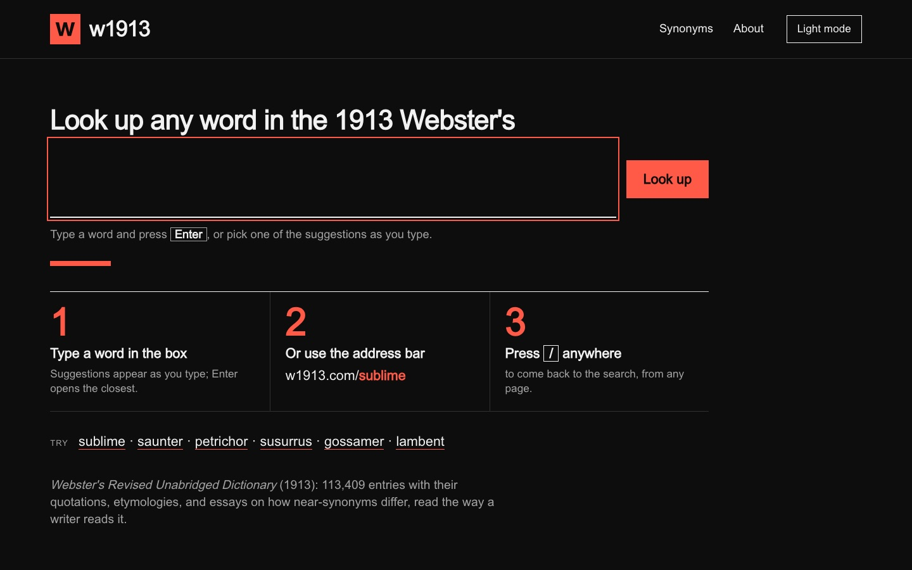
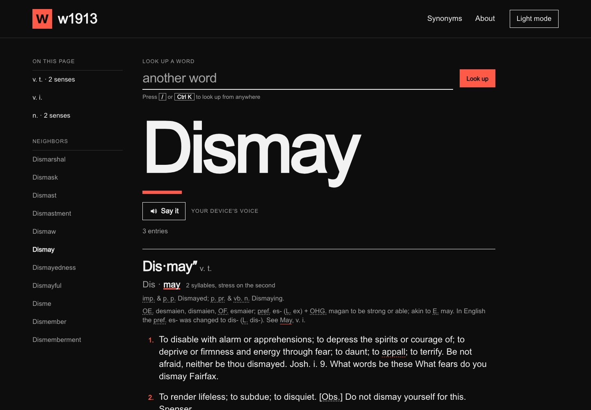
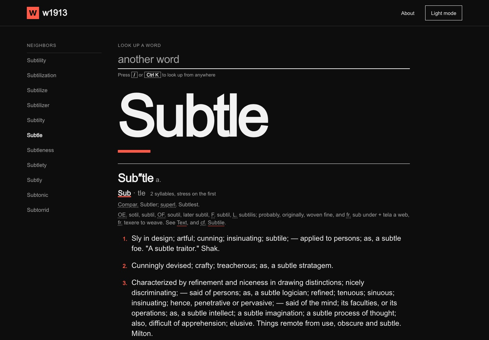
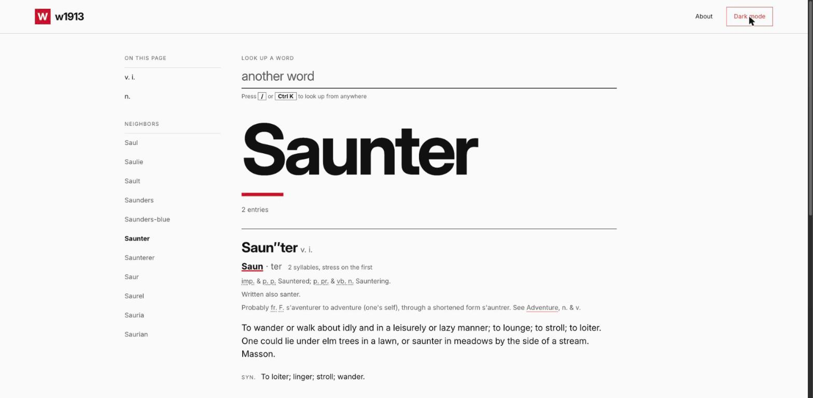
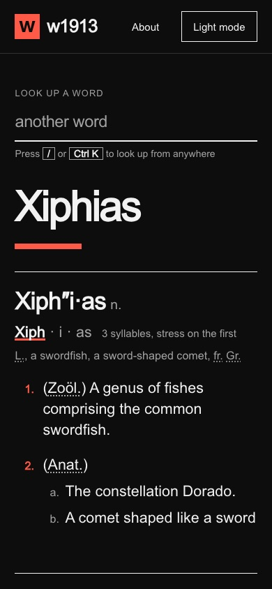

[](https://w1913.com)
[](CHANGELOG.md)
[](LICENSE)
[](LICENSE-DATA)
[](.nvmrc)
[](DESIGN.md#5-accessibility)

# W1913

A writer's tool built on *Webster's Revised Unabridged Dictionary* (1913, ed. Noah Porter), parsed from Project Gutenberg's public-domain plain-text edition.

The 1913 Webster's is loved for its discursive definitions, its literary quotations, and its short essays on how near-synonyms differ. Existing sites show it as a lookup box and a block of text. W1913 treats it as structured data and builds what that structure makes possible.

**Live at [w1913.com](https://w1913.com).** Type any word after the address: [w1913.com/sublime](https://w1913.com/sublime).



## What it does today

- **A readable entry for every word**, at its own address (`w1913.com/sublime`). Every homograph on one page; numbered senses and lettered sub-senses; notes, inflections, spelling notes, and etymology; cross-references as links.
- **Syllables and stress**, read from the dictionary's own marks: **Sub** · tle, "2 syllables, stress on the first".
- **Say it**: the headword spoken by your device's own voice, offline, with nothing sent anywhere.
- **Unusual-word previews**: a word in a definition that is rare in the dictionary's own definitions (*consternation*, *plagiarist*, *decennary*) has a dashed underline; point at it or tab to it for its first sense.

  
- **Abbreviations decoded**: *OE.* Old English, *fr.* from, *[Obs.]* obsolete, with a key at the foot of each page.
- **Words that point here**: the entries that say "See *X*", "Cf. *X*", or "Same as *X*".
- **Synonyms**: each entry's synonym list with every word linked; the dictionary's **624 essays** on how near-synonyms differ, shown on every word they compare and collected at [/synonyms](https://w1913.com/synonyms); "Listed as a synonym under" for each word; and a side-by-side **compare** page ([abandon, desert, forsake](https://w1913.com/synonyms/compare?w=abandon,desert,forsake)).
- **One-step lookup**: a large search field on every page, with suggestions as you type, `/` or Ctrl-K from anywhere, "did you mean" for a word not in the dictionary, and W1913 as a browser search engine.
- **Neighbors and a trail**: the entries around this one, as on the printed page, and the words you visited in this tab.
- **Look up by selection**: select a word in an entry to jump to it.
- **Dark and light themes**, fast on a phone (Lighthouse 100 for performance, accessibility, best practices, and SEO), and no WCAG 2.2 AA violations on any page type.
- **Private**: no accounts, no tracking cookies, and the words you look up are not logged.
- **Readable by machines**: a canonical address, descriptions, and schema.org structured data on every page (each entry is a `DefinedTerm`), plus [/llms.txt](https://w1913.com/llms.txt).



<p>
  
  
</p>

## What comes next

Each phase adds one layer to the edition and the features that rest on it (DESIGN.md §6):

| A writer asks | W1913 will answer with | Phase |
|---|---|---|
| What's the word for…? | Search inside definitions; browsing by label (obsolete, poetic, nautical) | 3 |
| I need a word with this rhythm. | Filters by syllable count and stress; a period check for a passage | 4 |
| How did the masters use it? | Quotations, searchable and browsable by author | 5 |
| Teach me a word. | Cards: decks at random, by label, by search, or from your own lists | 2 (next) – 6 |
| Can my own tools use it? | The edition as downloads and static files for Drafter and the Markdown editor, offline (no API) | 7 |

## How it is built

Two packages in one pnpm workspace:

- **`packages/data`** (plain TypeScript, run by Node 24) turns Project Gutenberg eBook #29765 into a versioned, layered edition of the dictionary: `w1913-<version>.jsonl`, one entry per line, validated against a schema. The site currently serves **edition 0.3**: 113,409 entries with their senses and synonyms.
- **`apps/site`** (Nuxt 4, Nuxt UI v4) imports the pinned edition into a read-only SQLite database, renders every entry to semantic HTML once at import, and serves it with server-side rendering.

Every published word comes from #29765, which Project Gutenberg catalogues as public domain. The older tagged edition (#660–670) is used only to measure the parser's accuracy and never supplies data; DESIGN.md §2 explains why. What the source text turned out to be, including its damage and gaps, is in [docs/phase-0-notes.md](docs/phase-0-notes.md).

## Documents

- [DESIGN.md](DESIGN.md): scope, sources, data model, interface, accessibility, and phases. The source of truth.
- [CHANGELOG.md](CHANGELOG.md): every version, with what changed.
- [KICKOFF.md](KICKOFF.md): the Claude Code prompt, the deploy contract, and the standing rules.
- [docs/phase-0-notes.md](docs/phase-0-notes.md): measurements of the source text.
- [docs/nginx-site.conf](docs/nginx-site.conf): a record of the live nginx config.
- [docs/ui/](docs/ui/): the original static mockups.

## Settings

The main settings live in one file, [`w1913.config.ts`](w1913.config.ts), at the repository root: the site's name and address, the edition the site serves, ports, deploy settings, interface limits, route words, footer links, and the colour theme. Its comments say what each setting does, what changing it means, and what not to change.

## Development

Requires Node 24 (`nvm use`) and pnpm 12 (`corepack enable`). Copy the canonical source to `cache/sources/29765.txt` first; it is not committed (the edition step verifies its SHA-256, and can download it when gutenberg.org is reachable).

```bash
pnpm install
pnpm dev                                    # clean caches, rebuild the edition and database, start Nuxt on :3913
pnpm test                                   # unit, golden, and coverage tests
pnpm lint && pnpm typecheck
pnpm --filter @w1913/data run edition       # build the edition releases (cached when unchanged)
pnpm --filter @w1913/site run db:import     # write the SQLite database for the pinned edition
pnpm --filter @w1913/data run phase0        # source audit → cache/phase0/report.json
```

## Versions and deploying

W1913 has one version, in the root `package.json`. Every release to `main` gets a new version, a section in [CHANGELOG.md](CHANGELOG.md) (a test fails without it), and a git tag. The site reports its version and commit at [`/healthz`](https://w1913.com/healthz) and in its footer.

The site runs under PM2 on a Forge-provisioned DigitalOcean droplet. Pushing to `main` does not deploy; after a push, click **Deploy** in Forge or run, on the droplet:

```bash
cd ~/w1913.com          # the checkout
./rebuild.sh --check    # preflight only
./rebuild.sh            # build a release, test it on a spare port, switch, check it
./rebuild.sh --rollback # back to the previous release
```

Each deploy builds a complete new release beside the live one, runs it on a spare port, and switches only if it answers. Then it checks the live port and the public address through nginx. Every check requires the new version and commit, and the smoke paths to answer. A failure at the live port rolls back automatically. The last line names what is live: `Deployed W1913 v0.6.1 (<commit>)`. `./rebuild.sh --help` lists the settings; DESIGN.md §3 "Deploying" explains the layout.

## Licence

- Code, documentation, and design: [MIT](LICENSE). The Inter typeface is under the SIL Open Font License ([apps/site/public/fonts/Inter-LICENSE.txt](apps/site/public/fonts/Inter-LICENSE.txt)).
- The published edition: [CC0 1.0](LICENSE-DATA). The 1913 text is in the US public domain; CC0 covers this project's tagging and corrections.

W1913 is independent of websters1913.com, Merriam-Webster, and every other dictionary site. Made in the [Metaincognita Workshop](https://metaincognita.com).
