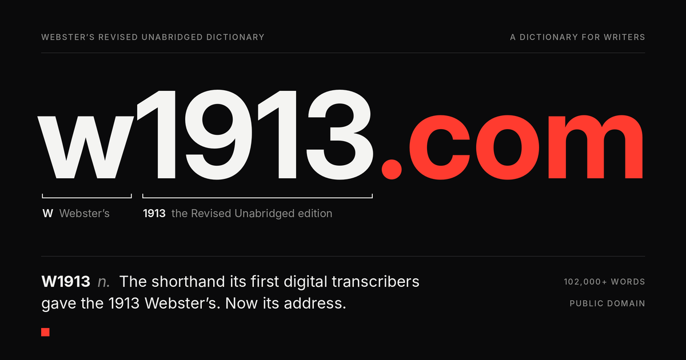

# W1913

A writer's tool built on *Webster's Revised Unabridged Dictionary* (1913, ed. Noah Porter).

The 1913 Webster's is loved for its discursive definitions, its literary quotations, and its short essays on how near-synonyms differ. Existing sites show it as a lookup box and a block of text. W1913 treats it as structured data and builds the things that structure makes possible.

**Status: planning.** Nothing is built yet. This repository currently holds the design and the kickoff prompt for the first phase of work. Planned home: `w1913.com`.

## What it will do

| A writer asks | W1913 answers with |
|---|---|
| What does this word really mean? | A readable entry, one step from the address bar: `w1913.com/sublime` |
| Is there a better word? | A thesaurus built from the dictionary's own synonym lists, plus its essays on near-synonyms |
| What's the word for…? | Search inside the definitions |
| I need a word with this rhythm. | Filter by syllable count and stress pattern |
| Would my 1890s narrator say this? | Paste a passage; see which words this dictionary does not contain |
| How did the masters use it? | Search the quotations, by author |
| Show me something. | Browse obsolete, poetic, dialect, and nautical words |

Accessibility is a requirement, not a later pass: the target is WCAG 2.2 AA with semantic HTML throughout.

## Where the name comes from

"W1913" is the shorthand the dictionary's first digital transcribers used for it: **W** for Webster's, **1913** for the edition.

## Sources

Two Project Gutenberg editions carry this dictionary, and the project uses them differently.

- **Canonical text: [eBook #29765](https://www.gutenberg.org/ebooks/29765).** Plain text, catalogued by Project Gutenberg as public domain in the USA. Every word W1913 publishes comes from this file.
- **Optional hints: eBooks #660–670, version 0.50.** A tagged transcription prepared by MICRA, Inc. These files may be read at build time to locate structures (quotations, authors, cross-references) in the canonical text. Their text and markup are never published, and the build must succeed without them.

The licence status of the tagged files is unclear: Project Gutenberg's catalog marks them as copyrighted, while the files themselves say the transcriber makes no proprietary claims. A question about this is with Project Gutenberg. The design does not depend on the answer; see [DESIGN.md](DESIGN.md), section 2.

No source files are committed to this repository. They are downloaded by script and verified against pinned checksums.

## How it is put together

Two packages in one pnpm workspace:

- **`packages/data`** turns the sources into a versioned, structured edition of the dictionary: one JSON object per entry, built up in layers.
- **`apps/site`** is the website. It imports a pinned release of the edition into SQLite and knows nothing about Gutenberg files.

Stack: Nuxt 4, Nuxt UI, TypeScript, SQLite with full-text search, deployed as a Node server.

## Roadmap

| Phase | What a writer gets |
|---|---|
| 0. Spike | Nothing yet: the segmenter is tested on letters X–Z |
| 1. Readable | Entry pages, address-bar lookup, autocomplete |
| 2. Better word | Thesaurus panel, synonym essays, compare view |
| 3. Word for it | Definition search, label browsing |
| 4. Rhythm and period | Stress filter, period check, lookup of inflected forms |
| 5. Hints | Quotation search, author pages, precise cross-reference links |
| 6. Keeping | Saved word lists, copy with citation |

Each phase is meant to be shippable on its own.

## Documents

- [DESIGN.md](DESIGN.md): the full design, including measured facts about the source texts, known problems, and risks
- [KICKOFF.md](KICKOFF.md): the Claude Code prompt for Phase 0

## Credits

- *Webster's Revised Unabridged Dictionary*, G. & C. Merriam Co., 1913, edited by Noah Porter
- [Project Gutenberg](https://www.gutenberg.org/) and its volunteers, for the transcriptions
- MICRA, Inc., for the original tagged electronic edition

W1913 is an independent project. It is not affiliated with or endorsed by Project Gutenberg or Merriam-Webster.

## Licence

Different parts of this project are covered by different terms.

| What | Terms | File |
|---|---|---|
| Code, documentation, and design | MIT License | [LICENSE](LICENSE) |
| The published structured edition (this project's tagging of the dictionary) | CC0 1.0 Universal | [LICENSE-DATA](LICENSE-DATA) |
| The dictionary text itself | Public domain in the United States | n/a |

Notes:

- No edition has been released yet. When one is, it will be released under CC0, so the tagged data is as free to reuse as the text it is built on.
- CC0 applies to the published edition only. That edition excludes any field derived from the MICRA-tagged files, whose status is unresolved (see Sources).
- Neither licence changes the status of the dictionary text. It was already in the public domain.
